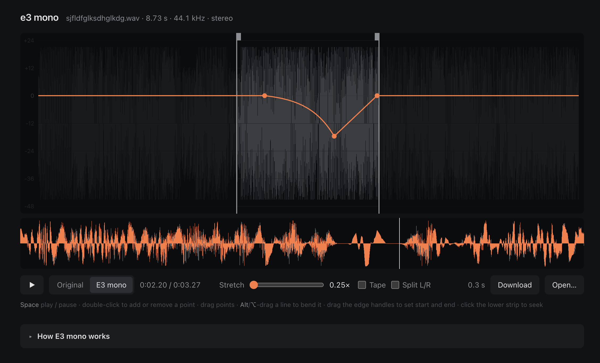

# e3 mono

FL Studio's "elastique 3 mono" time-stretch and pitch algorithm, rebuilt from the FL Studio 20 binary. Everything runs in your browser.

## Use

1. Open `index.html` in a browser.
2. Drop a sample on it.
3. Draw the pitch line, then press Space to listen.
4. Click Download to save the result as a WAV.

Pitch the sample down below −12 semitones to hear the crunch.

## Controls

- **Double-click:** add a point, or remove one.
- **Drag a point or a line:** move it. Hold Shift to snap to whole semitones.
- **Alt / ⌥ + drag a line:** bend the curve.
- **Click a point or the stretch number:** type in a value.
- **Drag the edge handles:** set where the sample starts and ends.
- **Space:** play or pause.
- **Original / E3 mono:** switch between the untouched sample and the result.
- **Tape:** speed and pitch slow down together, like a turntable stopping.
- **Linked / L/R / M/S:** how stereo is handled. Linked is what FL does. The other two aren't in FL.

The "How E3 mono works" section at the bottom of the page explains the math.
